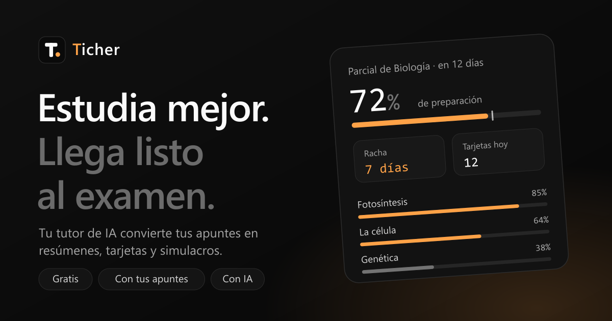

<div align="center">



# Ticher

**Tu tutor de IA para estudiar y preparar exámenes.**

Subí tus apuntes, armá un plan para tu próximo examen y estudiá con un tutor que te explica paso a paso.

[**ticher.pro**](https://www.ticher.pro) · Next.js 16 · React 19 · Gemini · Supabase

</div>

---

## Qué hace

### 🎓 Preparación de exámenes
- **Plan por temas:** cargás la fecha del examen y tus materiales (PDF, fotos, apuntes) y Ticher los divide en temas con su nivel de dominio.
- **Textos inteligentes:** cada tema se convierte en una lectura guiada por pasos, con definiciones, ejemplos, analogías y preguntas de control.
- **Varias formas de estudiar:** tarjetas de repaso, cuestionarios de opción múltiple, preguntas para responder por escrito y simulacros con tiempo.
- **Examen final:** todo el temario en una sola sesión, sin ayudas hasta entregar, con el resultado por tema.
- **Repaso espaciado:** las tarjetas vuelven justo cuando estás por olvidarlas.
- **Repasar mis errores:** las preguntas que fallaste quedan guardadas para volver a practicarlas.
- **Exportar a PDF** la lectura y las tarjetas de un tema.

### 💬 Tutor personal
- **Chat por materia** que responde a tu nivel y puede usar tus archivos y tu preparación de examen como contexto ("¿qué dice mi texto inteligente de Mitosis?").
- **Fórmulas bien escritas** con KaTeX.
- **Fotos y pizarrón:** subí una foto del ejercicio o dibujalo en el pizarrón integrado; las imágenes se convierten a WebP para ocupar menos.
- **Dictado por voz** y **modo socrático** (guía con preguntas en vez de dar la respuesta).
- Cada conversación recibe un título que resume de qué se habló.

### 🔥 Hábito
- **Racha, meta diaria** de minutos de estudio y página de actividad.
- **Calendario** con tus exámenes y eventos.
- **Recordatorios por email** 7, 3 y 1 día antes de cada examen.
- **Búsqueda global** con <kbd>Ctrl</kbd> <kbd>K</kbd>.

### 🌐 Lo demás
- Landing bilingüe (español e inglés), inicio de sesión **sin contraseña** con código por email, modo claro y oscuro y diseño adaptado a celular.
- Tus datos se sincronizan en la nube y tus archivos te siguen entre dispositivos.

## Stack

| Parte | Tecnología |
|---|---|
| Framework | [Next.js 16](https://nextjs.org) (App Router, Cache Components) y React 19 |
| Estilos | Tailwind CSS 4 y componentes [shadcn/ui](https://ui.shadcn.com) sobre Base UI |
| IA | [Google Gemini](https://ai.google.dev) (`@google/genai`), con respuestas estructuradas validadas con Zod |
| Datos y archivos | [Supabase](https://supabase.com) (Postgres y Storage), accedido solo desde el servidor |
| Emails | [Resend](https://resend.com) |
| PDFs | `pdfjs-dist` (convierte los PDF a texto para que la IA los lea más barato) |
| Fórmulas | [KaTeX](https://katex.org) |
| Hosting | [Vercel](https://vercel.com), con un cron diario para los recordatorios |

## Cómo correrlo en local

**Requisitos:** Node.js 20.9 o superior.

```bash
git clone https://github.com/fefeelopezz/ticher.git
cd ticher
npm install
```

Creá un archivo `.env.local` en la raíz con estas variables:

| Variable | Para qué | Obligatoria |
|---|---|---|
| `AUTH_SECRET` | Firma las sesiones. Cualquier texto largo y aleatorio (por ejemplo, `openssl rand -base64 32`). | ✅ |
| `GEMINI_API_KEY` | Clave de [Google AI Studio](https://aistudio.google.com/apikey). Sin ella la app funciona, pero sin IA. | Para la IA |
| `GEMINI_MODEL` | Modelo de Gemini a usar. Por defecto, `gemini-3.6-flash`. | No |
| `RESEND_API_KEY` | Envío de los códigos de acceso. En desarrollo, si falta, el código se imprime en la consola. | En producción |
| `RESEND_FROM` | Remitente de los emails. Por defecto, `Ticher <no-reply@ticher.pro>`. | No |
| `SUPABASE_URL` y `SUPABASE_SECRET_KEY` | Sincronización en la nube y archivos. Sin ellas, todo queda guardado en el navegador. | No |
| `CRON_SECRET` | Protege el cron de recordatorios. | En producción |
| `FEEDBACK_TO` | Email que recibe los mensajes del formulario "Ticher está en desarrollo". | No |

Después:

```bash
npm run dev
```

Abrí [http://localhost:3000](http://localhost:3000), ingresá tu email y usá el código que aparece en la terminal (o en tu correo, si configuraste Resend).

### Otros comandos

```bash
npm run build                # build de producción
npm run lint                 # ESLint
node --test lib/*.test.mjs   # tests de la lógica (progreso, sincronización, login, fórmulas…)
```

## Estructura

```
app/
  (app)/          Páginas con barra lateral: chat, exámenes, calendario, actividad, ajustes
  (focus)/        Lecciones a pantalla completa: texto inteligente, tarjetas, cuestionarios, simulacros
  (legal)/        Términos de uso y Política de privacidad
  api/            Rutas del servidor: IA (chat, generar, corregir), login, datos, archivos, feedback, cron
  login/          Inicio de sesión y registro
  welcome/        Landing pública
components/       Componentes de la interfaz (chat, pizarrón, barra lateral…) y ui/ de shadcn
lib/              Lógica: IA, autenticación, almacenamiento, sincronización, progreso; con sus tests
proxy.ts          Protege las rutas privadas y muestra la landing a quien no inició sesión
```

## Cómo funciona por dentro

- **Sin base de usuarios:** el login usa un código de 6 dígitos y cookies firmadas con HMAC. Con Supabase configurado, los intentos fallidos también se cuentan en el servidor, así que no sirve probar códigos por fuerza bruta.
- **El navegador primero:** los datos viven en `localStorage` y los archivos en IndexedDB, así todo responde al instante. Cuando hay Supabase configurado, se sincronizan en segundo plano y los archivos se suben directo a Storage con URLs firmadas.
- **La IA es intercambiable:** todas las llamadas pasan por `lib/ai.ts`. Si el modelo principal está saturado o sin cupo, se reintenta con uno más liviano.
- **Seguridad:** las claves de servidor nunca llegan al navegador, la base de datos no tiene acceso público (solo el servidor la lee) y las rutas privadas validan la sesión en cada pedido.

## Estado

Ticher está **en desarrollo** y se usa con un grupo reducido de personas. Si encontrás un error o tenés una idea, escribinos desde el aviso "Ticher está en desarrollo" dentro de la app.

---

<div align="center">
Hecho por Felipe · <a href="https://www.ticher.pro">ticher.pro</a>
</div>
